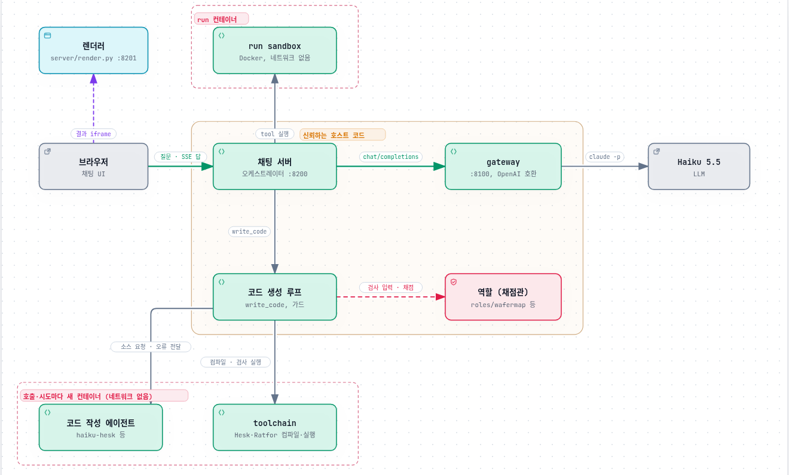

# vanilaChatbot

"실제로 문제를 해결하는 agent를 가진 chatbot"(ChatGPT agent / Claude Code Web 류)의 **기술 명세**와, 그 명세를 검증한 **MVP 코드**.

- 📄 명세: [docs/SPEC.md](docs/SPEC.md)
- 🔁 리서치↔테스트 루프 기록: [docs/LOOP_LOG.md](docs/LOOP_LOG.md)
- 📝 변경 기록: [docs/CHANGELOG.md](docs/CHANGELOG.md) (Loop별 추가·수정·신경 쓴 점, 리뷰에서 잡은 것)
- 🧭 다른 언어·다른 문제로 옮기기(측정으로 얻은 조언): [docs/ADAPTING.md](docs/ADAPTING.md)
- 🔎 리서치 노트: [docs/research/](docs/research/) (R1–R7)
- 📊 평가 결과: [docs/eval_results.json](docs/eval_results.json)

검증한 범위(Loop 0–10): OpenAI 호환 gateway(tool call 에뮬레이션 / Anthropic native), agent loop, Docker sandbox, RAG, GitHub 흐름, compaction, 인젝션 방어, **durable run(재접속·재시작 후 승인·crash 복구·취소)**, **pass^k 평가**. (egress allowlist·MCP 연동·tool 라우팅은 서버에 연결되지 않아 Loop 38에서 지웠다)

## 구조

LLM은 tool을 고르기만 하고 실행은 채팅 서버가 합니다. 모르는 언어의 코드 생성(`write_code`)에서는 코드 작성 에이전트와 toolchain(컴파일러)이 호출·시도마다 새 컨테이너에서 돌고, 받아들일지는 호스트의 역할 코드(정답 구현·채점)가 정합니다(컴파일 → 공개 예시 → 숨긴 검사). 노드마다 소스 위치가 붙은 대화형 버전은 [docs/architecture/architecture.html](docs/architecture/architecture.html)(내려받아 브라우저로 열기), 원본은 [architecture.json](docs/architecture/architecture.json)이며 [Archify](https://github.com/tt-a1i/archify)로 만들었습니다(`archify finalize architecture docs/architecture/architecture.json docs/architecture/architecture.html --repo-root .`).

LLM은 OpenAI 호환 Chat Completions만 가정합니다. 테스트에는 `claude -p`(Haiku 5.5)를 감싼 자체 gateway(`gateway/app.py`)를 사용했고, `LLM_BASE_URL`/`LLM_API_KEY`/`LLM_MODEL`만 바꾸면 다른 OpenAI 호환 모델로 그대로 동작합니다.

실행 방법은 [SPEC 부록 B](docs/SPEC.md#부록-b-실행) 참고.
